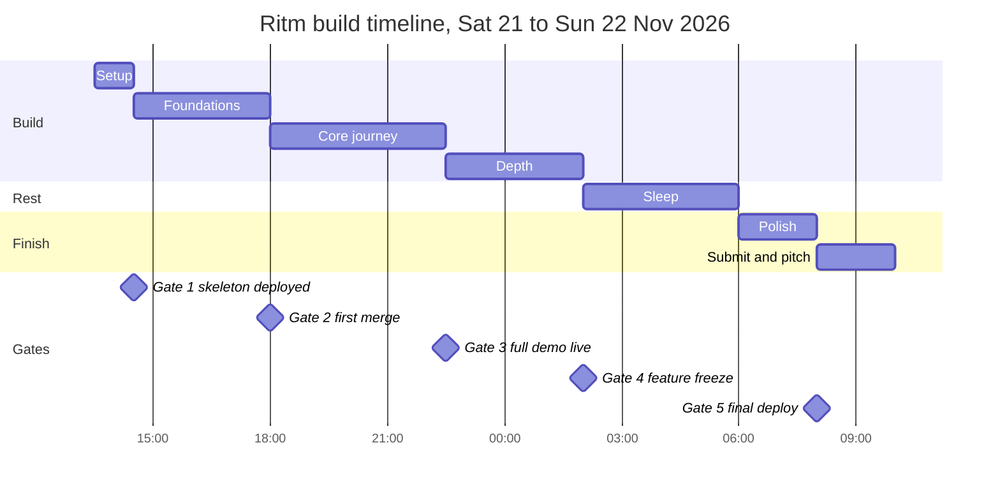

# Ritm by Atlas — Hackathon Roadmap

Nov 21, 2026 · Exported from the team's shared roadmap doc. If the doc changes, re-export.

## At a glance

We build Ritm, an opt-in feature inside Atlas (a fictional Romanian bank app), that protects a first salary from fast spending in the days after payday. It ships as a phone-sized web app on a live link, built in about 20 hours and pitched Sunday morning.

- **Who:** young Romanians who just received their first salary.
- **Problem:** money disappears fastest right after payday; banking apps only report spending after the fact.
- **Ritm:** watches the pace of spending since payday. The user chooses how strict it is: Heads-up, Speed bump or Lock.
- **Future:** locked money stays saved by default. In the Speed bump and at unlock, honest options appear, including Pillar III with Atlas's own pension fund, always explained first.
- **Business case for the bank:** more savings deposits, pension contributions into the group's fund, and the salary account of a customer for decades.

| Person | Owns | Main folders |
| --- | --- | --- |
| Cosma | Core and logic: rules engine, demo clock, data, chatbot server, merges | `lib/`, `app/api/` |
| Horia | Ritm screens: onboarding, Heads-up, Speed bump, Lock, unlock, pension explainer | `app/ritm/`, `components/ritm/` |
| Iustin | Atlas bank: shell, home, transactions, payments, notifications, chatbot UI, RO/EN | `app/(bank)/`, `components/bank/` |
| Pitcher | Copy (RO/EN), sourced numbers, survey, slides, demo script, backup video | `messages/` (text values), slides |

**Deadline assumption:** submission Sunday 09:00, pitches from 10:00. If the real times differ, shift every time in this doc by the same amount.

**Five golden rules**

1. One coherent journey beats many features. If a task doesn't appear in the demo, it waits.
2. The demo clock is sacred: we must be able to jump to day 1, 6, 20 and 30 in one tap.
3. Every visible text goes through the RO/EN files. No hardcoded words.
4. `main` always works and is always deployed. Broken code stays on a branch.
5. Feature freeze at 02:00. After that, only bug fixes and polish.

## 1. Product spec

The demo follows one person through one month: payday, a spending spike on day 6, a paused online purchase, the Lock opening on day 20, and payday again on day 30.

### Persona (illustrative numbers, the Pitcher replaces them with sourced ones by 18:00)

**Andrei, 23, first job as a junior QA tester in Cluj.** Net salary 4,800 lei on day 1. Essentials: rent 1,800 lei (shared flat), utilities 250, phone 50, transport pass 80. Goal: "Islanda 2027" (Iceland 2027), 9,000 lei. He has never had a budget and doesn't know he has a Pillar II pension fund.

Spending money for the month = 4,800 − 2,180 essentials − 500 Lock = **2,120 lei**.

### The journey (this is also the demo script)

1. **Day 1, payday.** "Salariu primit: 4.800 lei" appears on the Atlas home screen, with a card inviting Andrei to turn on Ritm.
2. **Onboarding, 3 steps.** What Ritm does (3 lines) → confirm detected essentials and add planned purchases → choose a level (Heads-up on by default; Speed bump and Lock optional), the goal, and a Lock amount (500 lei until day 20).
3. **Days 1–5.** The Ritm card on home shows "Safe to spend today: X lei" and a pace bar: money used vs. month passed.
4. **Day 6, spike.** A Heads-up notification: "Day 6: 55% of your spending money is gone. At this pace you'll run out on day 10, 20 days before payday." (1,166 of 2,120 lei spent in 6 days = about 194 lei a day.) One-tap actions: move 200 lei to the Lock, turn on Speed bump, or mark it as planned.
5. **Day 6, online purchase.** Andrei buys a 300-lei jacket at ModaHub (fictional shop). On Atlas's payment confirmation screen, the Speed bump appears: the purchase in goal terms, safe to spend today, and Confirm becomes active after 5 seconds. Options: Not now, Move to Lock, Put it toward my pension, Ask Ritm.
6. **Pension explainer (from the Speed bump).** Before anything moves, a sheet explains Pillar III, the trade-off (locked until retirement), the tax deduction, and that Atlas Pensii is Atlas's own fund. A required checkbox, then an explicit button.
7. **Day 20, Lock opens.** "You made it to the 20th without it." A slider defaults to keeping 100% saved. A comparison of where the kept money can go: flexible savings, government bonds (Tezaur/Fidelis), Pillar III, by **risk, access to the money, and time horizon**, not just return. This matches the brief's "Where should I keep money" prompt.
8. **Day 30, payday again.** Summary: reached payday with X lei left, Y lei saved, then a commitment: "Next raise: save half of it automatically?"

The **chatbot ("Ask Ritm")** opens from the Speed bump. It only explains Ritm, the numbers on screen and the options. It never tells the user what to buy or which fund to pick.

### Rules (single source of truth: `lib/engine`)

| Rule | Definition | Default |
| --- | --- | --- |
| Spending money | Net salary − essentials − Lock amount | — |
| Not counted | Essential categories, transfers between own accounts, refunds, purchases marked planned | — |
| Pace | % of spending money used ÷ % of month passed (expected spend never computed below day 3) | — |
| Watch / Spike | Pace ≥ 1.3 = watch, ≥ 1.6 = spike, only once ≥ 20% is spent | 1.3 / 1.6 / 20% |
| Burst | ≥ 25% of spending money spent in the last 48 hours = spike | 25% |
| Run-out forecast | Day money runs out at the current average daily spend; warn if ≥ 3 days before payday | 3 days |
| Safe to spend today | (money left + spent today) ÷ days left including today − spent today | — |
| Alert policy | Notify only when the level rises, or at most every 48 hours; after 2 ignored alerts, suggest Speed bump | 48 h / 2 |
| Speed bump trigger | Level on, non-essential **online card or in-app** payment ≥ threshold; Confirm active after a delay; switches off on payday | 100 lei / 5 s |
| In-store taps | No pause possible; instant feedback toast right after with the new safe-to-spend number | — |
| Lock | Chosen amount moves to savings on payday; unlocks automatically on the chosen day | 500 lei / day 20 |
| Early unlock | Released 24 hours after the request | 24 h |
| Emergency release | Up to 300 lei instantly, once per month, with a short reason | 300 lei |
| Turning Ritm off | Takes effect 24 hours later | 24 h |
| At unlock | Slider, default keep 100% saved | 100% |
| Interest shown | Flexible savings rate × days ÷ 365, minus 10% tax; labelled as an estimate with its source | Pitcher sources the rate |

All thresholds are starting assumptions. The pitch says so: a pilot would tune them.

### No-manipulation rules (apply to every screen)

- Explain before acting: every action that moves money shows what happens and the trade-off in one sentence.
- Pension is never a default and never pre-selected; it needs a checkbox plus an explicit button.
- Say openly that Atlas Pensii is Atlas's own fund and that other funds can be compared on the ASF website.
- No fake urgency. The only countdown is the Speed bump's confirm delay.
- Friendly tone, never shaming: "never taught", not "irresponsible".
- The user can always continue, unlock or turn Ritm off; only the timing has friction.

### What's real, simulated, or future

| Status | What |
| --- | --- |
| Working | Rules engine, demo clock, every screen in the journey, RO/EN switch, chatbot with live AI and offline fallback, state saved in the browser |
| Simulated | Bank core, card network, salary, transactions (synthetic), savings interest, pension fund transfers |
| Future | Real bank API integration, personal pace after 2–3 months of history, legal review (ASF, consumer protection), pilot to tune thresholds |

## 2. Tech stack and repo structure

One TypeScript codebase (Next.js) holds the screens, the rules and the chatbot's server part, deployed to Vercel from `main`.

| Part | Choice | Why |
| --- | --- | --- |
| Framework | Next.js (App Router) + TypeScript | One language everywhere; Claude Code is strongest here |
| UI | Tailwind CSS + shadcn/ui | Polished, accessible components fast (UX = 25%) |
| Motion | `motion` (formerly Framer Motion) | Sheets, banners and the Speed bump countdown feel real |
| State | Zustand with `persist` (browser storage, wrapped in try/catch) | No database; `Reset demo` restores day 1 |
| Translations | A tiny `useT()` hook + `messages/ro.json` and `messages/en.json` | No routing setup; switching language is instant |
| AI | `@anthropic-ai/sdk` in one server route | The key never reaches the browser; offline fallback answers |
| Tests | Vitest (rules), Playwright (journey) | Proves the engine works; catches broken flows |
| Hosting | Vercel, auto-deploy from `main` | Live link + QR code for judges; instant rollback |

### Folders and owners

```
artificial-inflation-2026/
  CLAUDE.md                 Cosma (others propose changes in chat)
  messages/ro.json, en.json everyone adds keys in their namespace; Pitcher edits text values
  app/
    (bank)/                 Iustin: home, transactions, payments, profile, layout
    ritm/                   Horia: onboarding, dashboard, unlock, summary
    api/chat/route.ts       Cosma
  components/
    bank/                   Iustin: PhoneFrame, nav, notifications, AskRitmSheet
    ritm/                   Horia: RitmCard, PaceBar, HeadsUpSheet, SpeedBumpSheet, LockScreen, PensionExplainer
    ui/                     shadcn components (add only with the shadcn CLI)
  lib/
    engine/                 Cosma: types.ts, pace.ts, alerts.ts, speedbump.ts, lock.ts (+ tests)
    data/                   Cosma: persona.ts, scenario.ts
    store/                  Cosma: useBank.ts, DemoControls
    chat/                   Cosma: systemPrompt.ts, fallbacks.ts
    i18n.ts, format.ts      Cosma (useT, formatLei)
  scripts/setup-claude.sh
```

### The contract that lets three people work in parallel

By **15:00** Cosma pushes `lib/engine/types.ts` and empty function signatures with the final names (`computePace`, `shouldShowSpeedBump`, `useBank` actions). Horia and Iustin build against those names with mock values until the 18:00 merge, so nobody waits for anybody.

### The chatbot's instructions (goes into `lib/chat/systemPrompt.ts`)

```
You are "Ask Ritm", the helper inside the Atlas banking app (a hackathon prototype).
You ONLY explain: how Ritm works (Heads-up, Speed bump, Lock), the numbers on the user's
screen (given in CONTEXT), and general facts about Romanian savings options and Pillar III
(given in FACTS).
Rules:
- Reply in the user's language (Romanian or English), at most 3 short sentences.
- Never tell the user to buy or not to buy something. Explain the trade-off and say the
  choice is theirs.
- Never recommend a specific investment or fund. Never promise or estimate returns.
- If asked about Atlas Pensii, say it is Atlas's own fund and that other funds can be
  compared on the ASF website.
- If the question is outside these topics, say you can only help with Ritm and the money
  in this app.
FACTS: Pillar III is a voluntary private pension; money stays invested until retirement;
contributions are deductible up to the lei equivalent of 400 EUR a year (shared with
private health insurance). Interest on bank savings is taxed at 10%.
CONTEXT: {safeToSpendToday} {pctSpent} {dayOfCycle} {goal} {purchase}
```

## 3. Setup checklist (13:30–14:30)

By 14:30 everyone runs the same skeleton locally and it is live on Vercel.

- [ ] **Cosma:** create the GitHub repo `artificial-inflation-2026`, add Horia, Iustin and the Pitcher as collaborators.
- [ ] **Cosma:** scaffold the app with prompt C1 (section 6), push to `main`.
- [ ] **Cosma:** add `scripts/setup-claude.sh`, run it through Claude Code (prompt C0), commit `.claude/skills`, `skills-lock.json`, `.mcp.json`.
- [ ] **Cosma:** add `CLAUDE.md` (text below) at the repo root, commit, push.
- [ ] **Cosma:** import the repo into Vercel, first deploy, post the live link in the team chat.
- [ ] **Cosma:** put the API key in Vercel (Settings → Environment Variables: `ANTHROPIC_API_KEY`, `ANTHROPIC_MODEL`) and locally in `.env.local`. Set a spending limit in the Claude Console.
- [ ] **Horia and Iustin:** clone, `npm install`, run the setup script without committing (prompt C0b), restart Claude Code, approve the MCP servers, run `npm run dev`.
- [ ] **Everyone:** open `localhost:3000` and check the phone frame shows.
- [ ] **Pitcher:** create the 5-question survey (Google Forms) and post it in hackathon and university chats; start the sources list.

### CLAUDE.md (first version, Cosma owns it)

```markdown
# Atlas · Ritm (hackathon prototype)

## What we're building
Atlas is a FICTIONAL Romanian bank, shown as a mobile web app (390×844).
Ritm is an opt-in Atlas feature for young people on their first salary: it watches the
pace of spending since payday and, at the level the user chooses, warns (Heads-up),
pauses online payments (Speed bump) or locks part of the salary in savings (Lock).
Pillar III (Atlas Pensii) is offered in the Speed bump and at Lock unlock, always
explained first and never as a default.

## Stack
Next.js App Router + TypeScript, Tailwind, shadcn/ui, Zustand (persist), motion,
Vitest, Playwright. Deployed on Vercel from `main`.

## Folder ownership (do not edit another person's folders; ask in chat)
- Cosma: lib/, app/api/, CLAUDE.md
- Horia: app/ritm/, components/ritm/
- Iustin: app/(bank)/, components/bank/
- Shared: components/ui (shadcn CLI only), messages/*.json (own namespace only)

## Code rules
- Every visible text uses useT('namespace.key') from lib/i18n.ts. Add each key to BOTH
  messages/ro.json and messages/en.json. Namespaces: common.*, bank.*, ritm.*. No hardcoded text.
- Money: formatLei(amount, locale) from lib/format.ts (RO: 1.234,56 lei; EN: 1,234.56 lei).
- Mobile first: design at 390×844; touch targets at least 44px; visible focus states;
  respect prefers-reduced-motion.
- Fictional merchants and brands only. Never use real bank names, logos or brand colours.
- All bank data is synthetic (lib/data). The only external call is /api/chat.
- Domain logic lives ONLY in lib/engine. Components call it; they never re-implement rules.
- Before saying a task is done: npm run build, npm test, and look at the screen with
  Playwright at 390×844. Fix what looks broken.

## Ritm rules (implemented in lib/engine; change numbers only there)
- Spending money = net salary - essentials - Lock amount.
- Not counted: essential categories, own transfers, refunds, purchases marked planned.
- Pace = % spending money used / % month passed (expected spend floored at day 3).
- watch >= 1.3, spike >= 1.6, only after 20% is spent; burst: >= 25% in 48h = spike.
- Run-out forecast: warn if money runs out >= 3 days before payday.
- Safe to spend today = (left + spent today) / days left incl. today - spent today.
- Alerts: only when the level rises or every 48h; after 2 ignored, suggest Speed bump.
- Speed bump: online card or in-app payments >= 100 lei, non-essential; Confirm active after
  5 s; off on payday. In-store taps: instant feedback toast instead.
- Lock: auto-unlock on chosen day; early unlock after 24h; emergency 300 lei once a month;
  turning Ritm off takes 24h. At unlock the slider defaults to keep 100% saved.

## Tone and ethics
Friendly, short, never shaming. Explain before any action that moves money, with the
trade-off in one sentence. Pension: never pre-selected, needs a checkbox + explicit button,
says Atlas Pensii is Atlas's own fund and that funds can be compared on the ASF website.
No fake urgency.

## Demo
Demo controls appear with ?demo=1: day slider, jumps to day 1/6/20/30, Reset demo.
```

## 4. Roles and tasks

Each developer owns one layer end to end; the codes in brackets point to the ready-made prompts in section 6.

### Cosma: core, logic and integration

1. **13:30–14:30, setup:** repo, scaffold, skills, CLAUDE.md, Vercel, API key \[C0, C1\].
2. **14:30–15:00, contract:** `lib/engine/types.ts` + empty function signatures, push, tell the team \[C2\].
3. **15:00–16:30, data:** Andrei's persona and a 30-day synthetic month with the day-1-to-6 spike \[C3\].
4. **16:30–18:00, engine + tests:** pace, alerts, speed bump trigger, Lock states, interest; Vitest green \[C4\].
5. **18:00, Gate 2:** merge everyone's branches, deploy.
6. **18:00–20:00, store + demo clock:** `useBank` store, notifications queue, DemoControls with day jumps and Reset \[C5\].
7. **20:00–22:30:** connect engine to Horia's and Iustin's screens with them; fix integration bugs; Gate 3 merge.
8. **22:30–01:00, chatbot server:** `/api/chat` with the system prompt, limits, timeout and fallbacks \[C6\].
9. **01:00–02:00:** Playwright test of the whole journey; feature freeze at 02:00.
10. **06:00–08:00:** bug fixes only, final deploy, keep the previous deploy ready for rollback.

### Horia: the Ritm experience

1. **14:30–15:30, design direction:** Ritm's look inside Atlas, tokens, PaceBar, safe-to-spend number, level chips on a playground page \[H1\].
2. **15:30–18:00, onboarding:** 3 steps (what Ritm does, essentials + planned purchases, level + goal + Lock amount) \[H2\].
3. **18:00–19:30, Ritm card + Heads-up:** home card with safe to spend and pace bar; Heads-up sheet with one-tap actions \[H3\].
4. **19:30–21:00, Speed bump:** the sheet inside Iustin's payment screen, 5-second confirm, goal impact, options \[H4\].
5. **21:00–22:30, Lock + unlock:** Lock screen (days left, early unlock 24h, emergency 300 lei), day-20 unlock with slider and the risk / access / horizon comparison \[H5\].
6. **22:30–00:30, pension explainer:** shared by Speed bump and unlock; checkbox + explicit button \[H6\].
7. **00:30–02:00:** day-30 summary + raise commitment; accessibility review with web-design-guidelines \[H7\].
8. **06:00–08:00:** visual polish from the rehearsal notes.

### Iustin: the Atlas bank

1. **14:30–16:30, brand + shell:** Atlas wordmark and globe mark (original), top bar with RO/EN toggle, bottom navigation, Home, Transactions \[I1\].
2. **16:30–18:00, accounts + formatting:** current and savings accounts, `formatLei`, category icons, transaction detail.
3. **18:00–20:30, payments:** ModaHub checkout → Atlas confirmation screen where the Speed bump plugs in; in-store tap with feedback toast \[I2\].
4. **20:30–22:30, notifications + salary:** phone-style banner for Heads-up, notification centre, salary-arrived moment and Ritm invite \[I3\].
5. **22:30–00:30, Ask Ritm UI:** chat sheet from the Speed bump, suggested questions, error fallback \[I4\].
6. **00:30–02:00:** Ritm settings in Profile (on/off with 24h rule, level, threshold); hardcoded-text sweep \[I5\].
7. **06:00–08:00:** test on real phones (iPhone Safari, Android Chrome), fix layout bugs.

### Pitcher: story, sources and validation (light coding)

1. **13:30–15:00:** survey live; sources table for every number on screen: entry-level net salary, Cluj or Bucharest rent, a flexible savings rate, Pillar III rules, the 22% financial literacy figure, BlackRock's 39% vs 8% finding.
2. **15:00–18:00:** write all Ritm and Atlas texts in RO and EN (friendly, short, never shaming); edit values in `messages/*.json` after 22:30, when keys are stable \[P1\].
3. **18:00–21:00:** slides v1 (5–6 slides), demo script v1; at Gate 3 use the live link as a first-time user and write a friction log for Horia and Iustin.
4. **21:00–00:00:** survey results → one slide; Q&A answers; rehearse alone. **Sleep at 00:00.**
5. **06:00–08:00:** final copy check in both languages; record the backup video at 07:30 from the final deploy.
6. **08:00–09:45:** submit, two full rehearsals with the team, final slide tweaks.

## 5. Timeline

Gate 3 at 22:30 is the real deadline: after it we only deepen and polish what already runs end to end.

| Time | Phase | What happens | Gate at the end |
| --- | --- | --- | --- |
| Sat 13:30–14:30 | Setup | Repo, skills script, CLAUDE.md, Next.js skeleton live on Vercel | Gate 1 · 14:30 · skeleton deployed, everyone runs it locally |
| Sat 14:30–18:00 | Foundations | Rules engine + data, bank shell + RO/EN, Ritm screens on mock values | Gate 2 · 18:00 · first merge: screens read from the engine |
| Sat 18:00–22:30 | Core journey | Payday → onboarding → Heads-up → Speed bump → Lock → unlock, end to end | Gate 3 · 22:30 · full demo runs on the live link; cut list decided |
| Sat 22:30–Sun 02:00 | Depth | Pension explainer, Ask Ritm chatbot, summary, tests, accessibility | Gate 4 · 02:00 · feature freeze: only fixes after this |
| Sun 02:00–06:00 | Sleep | Pitcher sleeps from 00:00, developers from 02:00 | — |
| Sun 06:00–08:00 | Polish | Bug fixes, real-phone tests, copy check, backup video at 07:30 | Gate 5 · 08:00 · final deploy + backup video saved |
| Sun 08:00–10:00 | Submit and pitch | Submit by 09:00 (assumed), two full rehearsals, pitch from 10:00 | — |

The same timeline as a chart (GitHub draws it; Claude Code reads the table above):



**What to do at each gate (Claude Code: follow these):**

- **Gate 1, 14:30:** stop, `git pull`, check `npm run dev` works and the live link opens. Only then start Foundations.
- **Gate 2, 18:00:** everyone pushes their branch; Cosma merges into `main`, runs build + tests, deploys. Screens switch from mock values to the real engine and store.
- **Gate 3, 22:30:** the full journey (day 1 → 6 → 20 → 30) must run on the live link. If something doesn't, apply the cut list in section 9 now.
- **Gate 4, 02:00:** feature freeze. No new features after this, only `fix/...` branches reviewed by Cosma.
- **Gate 5, 08:00:** final deploy, backup video saved locally, then only rehearsals.

Times assume submission at 09:00 and pitches from 10:00; if the organizers say otherwise, shift every time by the same amount. Whatever doesn't run end to end at Gate 3 follows the cut list in section 9.

## 6. Claude Code prompts (copy-paste)

Paste one prompt per task, in a fresh session, and let Claude Code finish before the next one.

**How to vibe code without losing hours**

- Run `git pull` before every prompt, so your Claude sees everyone's latest code and CLAUDE.md.
- For big tasks, start in plan mode (Shift+Tab), read the plan, then let it build. Type `/clear` between tasks.
- After each task: "Open the page with Playwright at 390×844, take a screenshot, and fix anything that looks broken or generic."
- If it loops on the same bug for 10 minutes: stop it, `/clear`, describe the bug in one sentence with the error message.
- Commit small and often: "Commit with a clear message and push to my branch."

### Cosma

**C0, run the setup script (once, Cosma only)**

```
Run `bash scripts/setup-claude.sh` from the repo root and read the output. If any step fails, find the cause (Node.js, network, pip, permissions), fix it and rerun until it ends with "All done". Don't change the list of skills or MCP servers. Show me the folders in .claude/skills and the contents of .mcp.json, then commit .claude/skills, skills-lock.json and .mcp.json with the message "chore: Claude Code skills + MCP setup" and push to main.
```

**C0b, Horia and Iustin after pulling**

```
Run `bash scripts/setup-claude.sh`, fix anything that fails, but don't commit anything.
```

**C1, scaffold**

```
Create a Next.js app in this repo root: App Router, TypeScript, Tailwind CSS, ESLint, no src folder. Add shadcn/ui (neutral base colour), zustand, motion, @anthropic-ai/sdk, and Vitest with a `npm test` script. Create the folder structure from CLAUDE.md with placeholder files. Create a tiny translation system: messages/ro.json, messages/en.json and lib/i18n.ts exporting useT() that reads the locale from a small zustand store (default 'ro') and returns t('namespace.key'), falling back to the key if missing. Create lib/format.ts with formatLei(amount, locale). Create components/bank/PhoneFrame.tsx: on screens wider than 500px it shows children inside a 390x844 rounded phone frame centred on a neutral background; on phones it fills the screen. Make the home page show "Atlas" inside the frame with a RO/EN toggle. Run lint, build and tests, fix every error, then commit and push to main.
```

**C2, the contract (by 15:00)**

```
Read CLAUDE.md. Create lib/engine/types.ts with the domain types: Transaction {id, day (1-30), amount in lei (positive = money out), merchant, category, channel: 'card_in_store' | 'card_online' | 'transfer' | 'salary', planned?: boolean}; RitmLevel = 'headsup' | 'speedbump' | 'lock'; RitmSettings {enabled, level, essentialCategories, essentialsTotal, goal {name, amount}, speedBumpThreshold, lock {amount, unlockDay}}; PaceState {dayOfCycle, cycleLength, pool, spent, remaining, pctSpent, pctMonthPassed, paceRatio, last48hSpent, projectedRunOutDay, safeToSpendToday, severity: 'ok' | 'watch' | 'spike', reasons: {key, values}[]}; LockState {status: 'locked' | 'unlockRequested' | 'unlocked', amount, unlockDay, requestedAtDay?, emergencyUsed}. In lib/engine create pace.ts, alerts.ts, speedbump.ts and lock.ts with the exported function names and signatures (computePace, shouldNotify, alertActions, shouldShowSpeedBump, requestUnlock, emergencyRelease, interestEstimate) returning simple placeholder values, each with a TODO. Commit and push to main.
```

**C3, synthetic data**

```
Create lib/data/persona.ts and lib/data/scenario.ts with one synthetic 30-day month for Andrei, 23, first job in Cluj. Put every amount in named constants with a comment "illustrative, replace with sourced figure": net salary 4800 lei on day 1; essentials rent 1800 (day 2), utilities 250 (day 5), phone 50 (day 3), transport pass 80 (day 1); Lock 500. Discretionary spending is heavy on days 1-6 (food delivery, an online fashion order, bar on Friday and Saturday, phone accessory) so that by the end of day 6 about 55% of spending money (2120 lei) is used, then calmer. Include one purchase marked planned (work shoes) and one refund. Use only fictional merchant names (e.g. FoodGo, ModaHub, Cafeneaua Nord, TechPunct). Export transactionsUntil(day) and a helper turning a day number into a date in the current month. Commit and push.
```

**C4, the rules engine with tests**

```
Implement the functions in lib/engine following the "Ritm rules" in CLAUDE.md exactly. computePace(transactions, settings, day) returns PaceState; reasons are i18n keys with values, not English sentences. shouldNotify(state, memory, day) and alertActions(state, memory). shouldShowSpeedBump(tx, settings, state): only for card_online or transfer, non-essential, not planned, amount >= threshold, Ritm level speedbump or lock. lock.ts: requestUnlock (released after 24h, i.e. the next day in the demo), emergencyRelease (max 300 lei, once per cycle), interestEstimate(amount, days, annualRate) minus 10% tax. Write Vitest tests using the scenario data: no alert on days 1-2; spike on day 6; rent and the planned purchase are not counted; safe to spend falls after a big purchase; emergency release refuses a second time. Run the tests until all pass, then commit and push.
```

**C5, store and demo clock**

```
Create lib/store/useBank.ts with zustand + persist (localStorage, every read and write in try/catch). State: locale, demoDay (1-30), all scenario transactions plus added ones, balances (current and savings), ritm settings, lock state, notifications queue, alert memory. Actions: setDemoDay, nextDay, addTransaction, enableRitm(settings), setLevel, lockMoney, requestUnlock, emergencyRelease, keepSaved(amount), dismissNotification, resetDemo. Whenever the day changes, run computePace and shouldNotify and push a Heads-up notification to the queue. Create lib/store/DemoControls.tsx: a small floating button visible only with ?demo=1 that opens a panel with a day slider, jump buttons for day 1, 6, 20 and 30, and Reset demo. Test the store with Vitest, then commit and push.
```

**C6, chatbot server route**

```
Create app/api/chat/route.ts. POST body {messages, context}. Use @anthropic-ai/sdk with ANTHROPIC_API_KEY and model from ANTHROPIC_MODEL (server env only, never sent to the browser), max_tokens 300, the system prompt from lib/chat/systemPrompt.ts (copy it from section 2 of our roadmap) with CONTEXT filled from the request. Reject input longer than 500 characters or more than 10 messages. Time out after 8 seconds. On any error, timeout or missing key, answer from lib/chat/fallbacks.ts: short RO and EN answers matched by keywords (what is Ritm, why the pause, what is Pillar III, how do I unlock). Add a Vitest test that the fallback works with no key. Commit and push.
```

### Horia

**H1, design direction**

```
Use the frontend-design skill. Read CLAUDE.md. Propose a visual direction for Ritm as a feature inside the Atlas bank app: calm, trustworthy and warm, not gamified, one accent colour for Ritm that works next to Atlas's colours, a type scale for big numbers. Put the tokens in the Tailwind theme / globals.css. Build components/ritm/PaceBar.tsx (money used vs month passed, two bars or one bar with a marker), SafeToSpend.tsx (big number + one line) and LevelChips.tsx, and a page app/ritm/playground showing them with mock values. Every text through useT() with keys in both messages files. Check it with Playwright at 390x844 and improve anything that looks generic. Then write 5 lines describing the Ritm design so I can send them to Cosma for CLAUDE.md. Commit and push to my branch.
```

**H2, onboarding**

```
Build the Ritm onboarding in app/ritm/onboarding as 3 steps with a progress indicator: (1) "Your first salary arrived" and what Ritm does in 3 short lines; (2) essentials: the detected recurring payments (rent, utilities, phone, transport) with toggles, plus "Add a planned purchase"; (3) choose protection: Heads-up (on by default), Speed bump, Lock with an amount slider (0-30% of salary) and unlock day (default 20), plus goal name and amount. Explain each level in one sentence. Save with the useBank actions (enableRitm); if the store isn't merged yet, use a local mock with the same names. All texts through useT() in both languages. Check with Playwright at 390x844, then commit and push.
```

**H3, Ritm card and Heads-up**

```
Build components/ritm/RitmCard.tsx for the Atlas home screen: safe to spend today (big), the PaceBar, the current level, the Lock amount and its unlock day, a link to Ritm. Build components/ritm/HeadsUpSheet.tsx that opens from a Heads-up notification: the reason sentences from PaceState.reasons (translated with their values), the run-out forecast, and three one-tap actions from alertActions (move money to the Lock, turn on Speed bump until payday, mark as planned). Each action calls a store action and shows a short confirmation. Check at 390x844 with the demo on day 6, commit and push.
```

**H4, Speed bump**

```
Build components/ritm/SpeedBumpSheet.tsx, which Iustin's payment confirmation screen renders. Props: purchase {merchant, amount}, paceState, goal, onConfirm, onCancel, onMoveToLock(amount), onPension(amount), onAskRitm. Show: "Quick check before you buy", the purchase, "Day X of 30 · Y% of your spending money used", the goal impact ("= N days of saving for Iceland", computed from the goal and the daily saving pace), safe to spend today. Buttons: Confirm (active after 5 seconds, with a visible filling ring and the seconds counting), Not now, Move it to the Lock, Put it toward my pension (opens PensionExplainer), and an "Ask Ritm" link. Respect prefers-reduced-motion (show the countdown as text only). Friendly copy, never shaming. Check at 390x844, commit and push.
```

**H5, Lock and unlock**

```
Build app/ritm/lock (Lock screen): amount locked, unlock date with days left, interest estimate labelled as an estimate, "Unlock early" (explains the 24-hour wait, then shows the release time), "Emergency: up to 300 lei now" (asks for a one-word reason, once per month). Build app/ritm/unlock for day 20: "You made it to the 20th without it", a slider defaulting to keep 100% saved, and a comparison of where the kept money can go: flexible savings, government bonds (Tezaur/Fidelis) and Pillar III, compared by risk, access to the money and time horizon, with an honest one-line trade-off each and no promised returns. Choosing Pillar III opens PensionExplainer. Check at 390x844, commit and push.
```

**H6, pension explainer**

```
Build components/ritm/PensionExplainer.tsx, used from the Speed bump and the unlock screen. Before any action it explains: Pillar III is a voluntary private pension; the money stays invested until retirement and cannot be used before; contributions are tax-deductible up to the equivalent of 400 EUR a year (shared with private health insurance); Atlas Pensii is Atlas's own fund and other funds can be compared on the ASF website (link). Amount field prefilled with the purchase or kept amount, a required checkbox "I understand this money is for retirement", then "Contribute X lei" and "Not now". Nothing pre-selected, no urgency words. All texts through useT(). Commit and push.
```

**H7, summary and accessibility**

```
Build app/ritm/summary for day 30: reached payday with X lei left, Y lei kept saved, the month's pace as a simple line, and the commitment card "Next raise: save half of it automatically?" (on/off). Then use the web-design-guidelines skill to review everything in app/ritm and components/ritm; fix contrast, focus states, button labels, touch targets of at least 44px and reduced motion. Commit and push.
```

### Iustin

**I1, brand and shell**

```
Use the frontend-design skill. Read CLAUDE.md. Atlas is a fictional Romanian bank: design an original wordmark (text) and a simple globe mark (a circle with meridians) in SVG that doesn't resemble any real bank. Build the app shell inside PhoneFrame: top bar with the Atlas wordmark and the RO/EN toggle, bottom navigation (Home, Payments, Ritm, Profile), Home (greeting, current account balance with formatLei, savings account, a slot that renders Horia's <RitmCard/> if it exists or a placeholder, last 5 transactions) and Transactions (grouped by day, category icons, essentials marked). All texts through useT() in both languages. Check with Playwright at 390x844, commit and push to my branch.
```

**I2, payments and the Speed bump slot**

```
Build the simulated online purchase: a page showing a fake checkout from the fictional shop ModaHub ("Jacket, 300 lei", "Pay with Atlas") that leads to Atlas's payment confirmation screen, styled like a bank's online-payment approval step (amount, merchant, card ending 4821, Confirm, Cancel). Before Confirm, call shouldShowSpeedBump from lib/engine; if true, render Horia's <SpeedBumpSheet/> (or a placeholder with the same props until it exists). On confirm, add the transaction through useBank. On the Payments tab add "Simulate in-store tap" (Cafeneaua Nord, 180 lei) that shows a toast right after: "You just spent 180 lei at Cafeneaua Nord. Safe to spend today: X lei." Check at 390x844, commit and push.
```

**I3, notifications and salary**

```
Build in-app notifications: a phone-style banner that slides down from the top for items in the useBank notifications queue; tapping a Heads-up opens Horia's <HeadsUpSheet/>. Add a notification centre behind a bell icon. On day 1, show a "Salary received: 4,800 lei" moment on Home and, if Ritm is off, the invitation card that opens the onboarding. Respect prefers-reduced-motion. Commit and push.
```

**I4, Ask Ritm chat**

```
Build components/bank/AskRitmSheet.tsx, opened from the Speed bump's "Ask Ritm" link. Two suggested questions as chips ("What is Pillar III?", "Why the pause?"), the message list, an input limited to 500 characters, a typing indicator, POST to /api/chat with {messages, context: {safeToSpendToday, pctSpent, dayOfCycle, goal, purchase}}, and a friendly error text if the call fails. Under the input: "Ritm explains; it doesn't decide for you." All texts through useT(). Commit and push.
```

**I5, settings and text sweep**

```
Add Ritm settings in Profile: on/off (turning off takes effect in 24 hours, say so), level, Speed bump threshold, essentials list. Then search the whole app for hardcoded visible text, move every string into messages/ro.json and messages/en.json, and check with Playwright that switching the language changes every visible text on Home, Payments, the Speed bump and the Lock screens. Also check at 360x800. Commit and push.
```

### Pitcher

**P1, copy pass (after 22:30)**

```
Read CLAUDE.md, messages/ro.json and messages/en.json. Rewrite the text values (never the keys) so every Ritm and Atlas text is short, friendly and never shaming, uses natural Romanian (not a translation of the English), and matches between the two files. Don't add or remove keys. Show me the 15 most changed lines before saving, then commit and push to my branch.
```

## 7. Git rules

`main` is always deployable, and only Cosma merges into it, at the gates and when someone asks.

1. One branch per person: `cosma/...`, `horia/...`, `iustin/...`, `pitcher/copy`. Push to your branch often.
2. Stay in your folders (section 2). Need a change elsewhere? Ask the owner in chat.
3. `messages/*.json`: add keys only in your namespace (`bank.*`, `ritm.*`, `common.*`). The Pitcher changes text values only after 22:30, when keys are stable.
4. `package.json`: only Cosma adds dependencies. Ask him if you need a package.
5. Before asking for a merge: `git pull origin main`, then `npm run build` and `npm test` must pass on your branch.
6. Merge conflict? Tell Claude Code: "Resolve the merge conflicts keeping both sides' changes, then run build and tests." Read what it changed before pushing.
7. Never force-push, never commit `.env.local` or the API key.
8. After the 02:00 freeze: `fix/...` branches only, Cosma reviews each before merging.
9. If a deploy breaks the live link: roll back to the previous deploy in Vercel (Deployments → previous → Promote), then fix calmly.

## 8. Pitch (4 minutes + Q&A)

Two of the four minutes are the live demo; everything else sets it up or answers the rubric.

| Time | Part | What we show and say | Rubric |
| --- | --- | --- | --- |
| 0:00–0:30 | Hook | "Day 6 after your first salary. 55% of your spending money is gone." + our survey result | Pitch |
| 0:30–1:00 | Who and why | First-salary Romanians; Romania has the lowest financial literacy in the EU (22%); habits form at the first job (BlackRock: 39% uptake for new employees vs 8% for existing) | Business fit: Romania |
| 1:00–3:00 | Live demo | Day 1 payday → onboarding → day 6 Heads-up → ModaHub purchase with Speed bump → pension explainer → day 20 unlock, keep saved, compare options → day 30 summary | UX, Technical |
| 3:00–3:30 | Why a bank buys it | Any bank can switch on Ritm: savings deposits, contributions to its own pension fund, the salary account for life. Different from budgets (they report after) and impulse blockers (one purchase): we watch the month's pace | Business fit: differentiation, adoption |
| 3:30–4:00 | Reality | Works: engine, journey, RO/EN, chatbot. Simulated: bank core, cards, data. Next: bank API, legal review (ASF), pilot to tune thresholds. Ethics: consent, explain-first, no defaults into pensions | Pitch: honest limits |

The brief's five demo points are covered: **Who** (0:30), **How** (the demo), **Value** (unlock + summary), **Romania** (0:30 and the pension options), **Reality** (3:30).

### Likely judge questions and short answers

- **"Who actually turns this on?"** It's offered at the first salary, when people are most open; the light level is on by default, the strong ones are opt-in.
- **"Isn't this just a budget?"** Budgets look at amounts per category after the fact. Ritm looks at time: how fast money goes since payday, and acts before the damage.
- **"How do you tell an impulse buy from a needed one?"** Essentials and planned purchases never count. We show it live: the planned work shoes don't trigger anything.
- **"Why would a bank reduce card spending?"** It gains deposits, pension fund contributions and a customer for decades; it loses little card fee income.
- **"Isn't offering your own pension fund manipulative?"** It's never a default, it's explained first, we say it's our fund, and we link the regulator's comparison.
- **"Where do 1.3 and 1.6 come from?"** Starting assumptions, stated as such. A pilot would tune them, and after 2–3 months Ritm would compare with the user's own pace.
- **"What about data and consent?"** Opt-in, transaction data the bank already holds, nothing leaves the bank except the chatbot question, and the chatbot never sees account numbers.

## 9. Risks and fallbacks

The demo must survive any single failure, so every risk below has a fallback ready before 08:00.

| Risk | Fallback |
| --- | --- |
| Behind schedule at Gate 3 (22:30) | Cut in this order: chatbot, day-30 summary, English (keep Romanian). Never cut: demo clock, Heads-up, Speed bump, Lock and unlock |
| Chatbot API fails or no key | Fallback answers already built in; the demo doesn't depend on it |
| Wi-Fi fails during the pitch | Run the production build locally (`npm run build && npm start`) on the pitch laptop; backup video as last resort |
| A late deploy breaks the live link | Promote the previous deploy in Vercel, then fix on a branch |
| Merge conflicts in shared files | Namespaced keys, one owner per folder, Cosma merges at gates |
| Claude Code produces generic-looking UI | frontend-design skill + Horia's tokens; ask for a Playwright screenshot and a redesign of the weakest screen |
| Demo state gets messy on stage | `Reset demo` + day jumps in DemoControls; rehearse the exact clicks |
| English text appears in the Romanian demo | Iustin's text sweep (I5) + a language check in the final checklist |
| Exhausted team | Sleep shifts are part of the plan; nobody codes after 02:00 except fixes in the morning |

## 10. Final checklist (Sunday 08:00–09:00)

Tick every box before submitting.

- [ ] The live link opens on an iPhone (Safari) and an Android phone (Chrome); the QR code on the slide points to it.
- [ ] Reset demo → day 1, Romanian language, Ritm off.
- [ ] The full journey runs three times in a row without errors, using only the planned clicks.
- [ ] Switching to English changes every visible text on the demo screens.
- [ ] The chatbot answers in both languages, and the fallback works with the network off.
- [ ] Every number on screen is sourced or labelled "illustrative"; the sources slide is done.
- [ ] The Reality slide lists what works, what's simulated and what's next.
- [ ] Backup video (under 3 minutes) is saved on the pitch laptop, not only online.
- [ ] Pitch laptop: charger, display adapter, notifications off, browser zoom 100%, demo tab open with `?demo=1`.
- [ ] Submission form: updated description, repo link, live link, video link.
- [ ] `.env.local` isn't in the repo; the API key has a spending limit (revoke it after the event).
- [ ] Everyone has read the Q&A answers in section 8.

## 11. Additions after the first review

These additions came after sections 1–10 were written. Where an addition changes an earlier section, the earlier text is replaced by the version here. Each item says which part it changes and who owns it.

| # | Addition | Changes | Owner | Priority |
| --- | --- | --- | --- | --- |
| A | My month plan in onboarding, editable later | Journey step 2, H2 | Horia, Cosma | Must run at Gate 3 |
| B | Lock amount with a live impact preview | Journey step 2, Lock rules, H2, H5 | Horia, Cosma | Must run at Gate 3 |
| C | Lock override with a reason ("the mirror") | Early unlock + Emergency release rules, H5 | Horia, Cosma | Must run at Gate 3 |
| D | Simulate a payment from the demo controls | C5 DemoControls, I2 | Cosma, Iustin | Must run at Gate 3 |
| E | Speed bump that teaches without overwhelming | Journey steps 5–7, H4, H5, H6 | Horia | Depth (22:30–02:00) |
| F | Habits and a personal pace, shown in a 2nd month | Rules, C3, C4, C5, Heads-up | Cosma, Horia | Depth, cut first |

### A. My month plan

- Onboarding stays 3 steps. Step 2 shows the plan pre-filled from what the bank already knows (salary, recurring bills); the user confirms and adjusts instead of typing.
- The goal has an amount and a date. The plan shows the monthly amount needed to reach it; if that's more than is realistic, it shows the date reachable with the chosen Lock instead.
- Step 3 ends on one summary card: Salary → Bills → Lock → **Spending money → about X lei a day**.
- The plan is editable any time from the Ritm card and from Profile.
- **Edit rule:** anything that makes the plan safer (more in the Lock, a new goal) applies instantly. Lowering the Lock mid-month goes through the same reason screen and 24-hour wait as cancelling the Lock (C). There is no back door around the Lock.

### B. Lock amount with impact preview

- Slider plus three quick buttons (300 / 500 / 800 lei).
- As it moves, one line updates: spending per day, what comes back on the unlock day with the interest estimate, and the goal progress in %.
- If the daily amount drops below 30 lei, a gentle warning: "This leaves under 30 lei a day. That's tight."

### C. Lock override with a reason (the mirror)

- Cancelling the Lock always asks for a reason. The screen shows facts first, no judgement: "Unlocking 300 lei: Iceland goes from 34% → 28% · this is your 2nd unlock this month" (example format; the real numbers come from the engine).
- Reason buttons: **Health · Bill or repair · Unexpected cost · Something I want**, plus an optional short note.
- The first three use the emergency release (up to 300 lei instantly, once per month); above that, or the second time, the 24-hour wait applies. **Something I want** always means the 24-hour wait. It is never blocked.
- Reasons are stored and come back in the month summary ("Last month you unlocked once for 'Something I want'. Keep the Lock at 500, or try 400?").
- Copy rule: the mirror is the facts and the user's own choice of reason. The app never adds blame.

### D. Simulate a payment

- DemoControls gets a "Simulate payment" block: amount 50 / 150 / 300 lei, online or in-store.
- Online goes through the ModaHub checkout (I2) with the chosen amount; in-store shows the feedback toast.
- What it shows: 50 lei online → no Speed bump (under the threshold); 300 lei online → Speed bump; 300 lei in-store → toast only.

### E. Speed bump that teaches without overwhelming

- **No info dumps:** one line and one number per option; details are one tap deeper, only if the user asks.
- The Speed bump shows the purchase in goal terms, then:
  - **Save it:** "Keep it, spend it whenever you want. +~X lei by payday." (interest estimate, labelled)
  - **Pillar III:** "Lower taxes now. Locked until retirement." (the tax saving in lei)
  - **Skip it:** "Your safe-to-spend stays at X lei today."
  - **Buy anyway** stays just as visible as the others.
- The pension explainer becomes 3 short steps instead of one block: what it is (one sentence) → what you get (the tax saving in lei) → the catch (locked until retirement). Then the checkbox and the button. No projected returns anywhere.
- The unlock comparison uses three simple indicators per option (access to money, risk, time horizon), not a table.

### F. Habits and personal pace (deterministic, no AI)

- **No AI decides anything.** These are pure functions in `lib/engine`: the same history always gives the same result, and every rule has a test. The chatbot only explains.
- **Habit:** a merchant that appears in at least 3 of the last 4 weeks with an amount within ±25% of its usual amount (e.g. Cafeneaua Nord, ~17 lei, weekly).
- **Personal pace:** from the 2nd month, expected spending by day comes from the user's previous months instead of an even line. Month 1 uses the rules in section 1.
- **Tone, not math:** habit spending still counts toward the spending money. If the extra pace comes mostly from habits and the money still lasts until payday, the user gets the soft note ("Your usual coffee rhythm. You're on track for it this month") instead of the Heads-up. If the money would run out early, the normal Heads-up comes, worded gently.
- **2nd month in the demo:** the scenario gets a month 1 with weekly coffee and one unlock for "Something I want", and a month 2 where Ritm uses them: the soft habit note, a summary that refers back to last month, and a plan suggestion based on real spending. DemoControls gets a "Month 2" jump.

### Prompts

**C7, engine additions (after Gate 2)**

```
Read section 11 of docs/ROADMAP.md. In lib/engine add: lockPreview(plan, lockAmount, day) returning spending money, per-day amount, amount back on unlock day with interestEstimate, goal progress and a tight flag under 30 lei a day; goalPlan(goal, plan) returning the monthly amount needed or the reachable date; requestUnlock(reason, note) with reasons health, bill, unexpected, want, where the first three use emergencyRelease (max 300 lei, once per cycle) and everything else waits 24h; planEdit(old, new) that applies instantly when safer and routes a lower Lock through requestUnlock. Add detectHabits(transactions, day): a merchant in at least 3 of the last 4 weeks with amounts within ±25% of its median; personalExpectedSpend(history, day) using previous months' average cumulative spend, falling back to the section 1 rule with no history; and an alert variant "habit" when the extra pace comes mostly from habits and the run-out forecast is not before payday. Everything pure and deterministic, reasons as i18n keys. Write Vitest tests for each rule, run until all pass, then commit and push.
```

**C8, second month and demo controls**

```
Read section 11 of docs/ROADMAP.md. Extend lib/data/scenario.ts to two months: month 1 is the existing month plus a weekly coffee at Cafeneaua Nord (about 17 lei) and one Lock unlock with reason "want"; month 2 keeps the coffee habit, has habit-only extra spending in the first week and no big spike. In useBank store unlock reasons and the plan, and add setMonth. In DemoControls add a Month 1 / Month 2 switch and a "Simulate payment" block (50 / 150 / 300 lei, online or in-store) that calls the existing payment flow. Test with Vitest, then commit and push.
```

**H8, plan, Lock preview and the mirror**

```
Read section 11 of docs/ROADMAP.md. Update onboarding: step 2 is "My month plan", prefilled from the store, with goal amount and date and the goalPlan result; step 3 ends on a summary card Salary → Bills → Lock → Spending money → per day. Add an "Edit plan" screen reachable from the Ritm card, using planEdit. Replace the Lock amount input with a slider plus 300/500/800 buttons and the live lockPreview line, with the gentle warning when tight. Replace the early unlock / emergency flow with the mirror screen: facts first (goal progress before → after, unlock count this month), then the four reason buttons and an optional note. No blaming words. All texts through useT(). Check at 390x844, commit and push.
```

**H9, teaching without overwhelming**

```
Read section 11 of docs/ROADMAP.md. In SpeedBumpSheet show three options with one line and one number each (Save it, Pillar III, Skip it) plus an equally visible Buy anyway; details open one tap deeper. Split PensionExplainer into 3 short steps (what it is, what you get in lei, the catch) before the checkbox and button; no projected returns. In the unlock comparison use three small indicators per option (access, risk, horizon). Add the soft "habit" variant of the Heads-up. All texts through useT(). Check at 390x844, commit and push.
```

**P2, copy for section 11 (after the new keys exist)**

```
Read section 11 of docs/ROADMAP.md, CLAUDE.md and messages/*.json. Rewrite the text values of every key added for section 11 (plan, Lock preview, mirror screen, reason buttons, Speed bump options, pension steps, habit note) following P1's rules: short, friendly, never shaming, the mirror shows facts and never blames. Don't add or remove keys. Show me the changes before saving, then commit and push to my branch.
```

### Pitch changes (section 8)

- The live demo stays at 2:00: show days 1–5 in passing, keep the pension explainer short, add a one-tap jump to month 2 (about 20 s) for the habit note and the summary that refers to last month.
- New judge answers:
  - **"Is this AI?"** "No AI decides anything about your money. The rules are deterministic and tested; AI only explains."
  - **"Why make me give a reason?"** "It's a mirror, not a lock. You always get your money; you just see what it costs you first."

### Cut list (replaces the order in section 9)

If behind at Gate 3: cut F (habits and month 2) first, then the chatbot, the day-30 summary, English. A–D are part of the core journey and are never cut.
